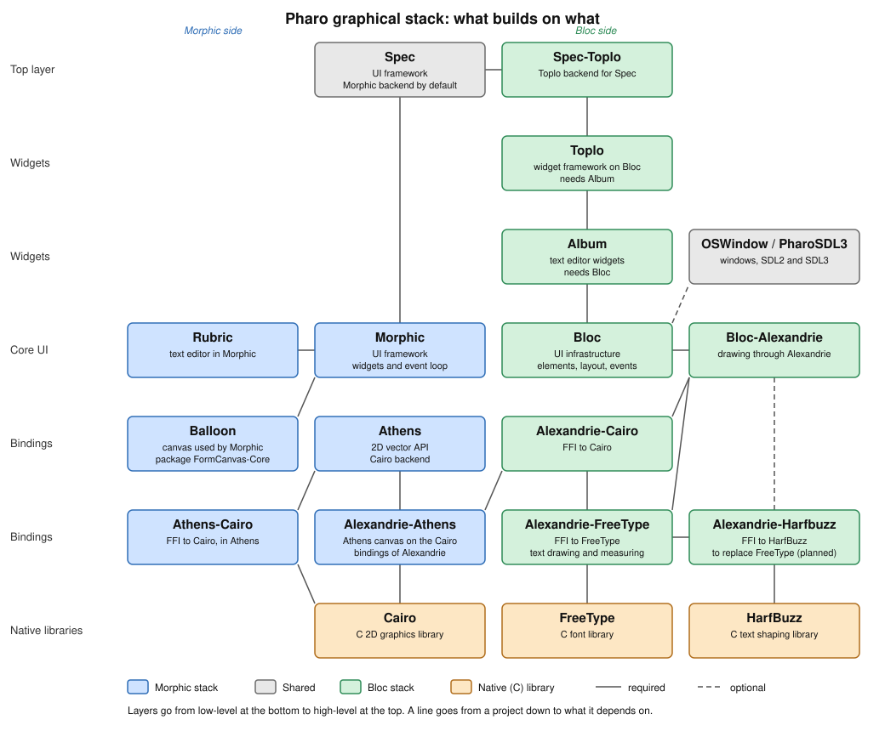

# Pharo graphical stack

Pharo has several graphical projects, and it is not obvious which one does what or which one depends on which.
This page lists them, says in which Pharo version they are available, gives the repository reference to load them when they are not in the image, and describes their dependencies.

The projects belong to two stacks:

- **Morphic stack**: the historical UI and 2D graphics of Pharo, built on Morphic and Athens (Balloon is the canvas Morphic draws with).
- **Bloc stack**: the newer UI infrastructure, [Bloc](https://github.com/pharo-graphics/Bloc), and the projects built on it ([Album](https://github.com/pharo-graphics/Album), [Toplo](https://github.com/pharo-graphics/Toplo), [Spec-Toplo](https://github.com/pharo-graphics/Spec-Toplo)).

Some projects are shared by both stacks (OSWindow, SDL, Spec, Roassal). They are marked as such in the tables.

## Words used on this page

- **Connector** (Telescope): the part that draws a Telescope visualization with a graphical framework.
- **FFI (foreign function interface)**: how Pharo calls the functions of a C library.
- **Glyph**: the drawing of one character in a font.
- **Morph** (Morphic) and **element** (Bloc): the objects that make up the screen.
- **Presenter** (Spec): a UI part described without its widget. An adapter turns it into a widget.
- **Rasterizing**: turning shapes into pixels.
- **Shaping**: turning a string into positioned glyphs, with ligatures and scripts that join letters (Arabic, Indic).
- **Spatial index**: a data structure that finds shapes by their position quickly.
- **Surface or canvas**: where drawing ends up, for example an image in memory or the screen.
- **VM plugin**: C code compiled into the virtual machine rather than the image.

## Stack at a glance



Roassal, Telescope and Telescope-Bloc are left out of the picture to keep it readable. See their sections below.

## Summary by project

| Project | Stack | In the Pharo image | Pharo versions | Depends on |
| --- | --- | --- | --- | --- |
| Album | Bloc | No, loadable in Pharo 14 | Not in Pharo 15 | Bloc, Alexandrie (optional) |
| Alexandrie | Bloc | No (outside Pharo) | Not in Pharo | Cairo, FreeType and HarfBuzz, provided by the Pharo VM |
| Athens | Morphic | Yes | In Pharo 15 | Cairo (through Athens-Cairo) |
| Balloon | Morphic | Yes, package `FormCanvas-Core`, tag `FormCanvas-Core-BalloonEngine` (Pharo 15) | Pharo core | Morphic canvas, parts to confirm |
| Bloc | Bloc | No, loadable in Pharo 14 | Not in Pharo 15 | Nothing outside Bloc |
| Cairo | Morphic | Bindings in Athens-Cairo | In Pharo 15 | Cairo C library |
| Morphic | Morphic | Yes | All versions | Pharo core |
| OSWindow | Shared | Yes | In Pharo 15 | SDL2 |
| Roassal | Morphic | Yes | In Pharo 15, Pharo 14 release | RoassalLayouts |
| Rubric | Morphic | Yes | In Pharo 15 | Morphic |
| SDL2 | Shared | Yes (OSWindow-SDL2) | In Pharo 15 | SDL2 library |
| SDL3 | Bloc | No | Loaded manually, see [SDL](#sdl) | SDL3 library |
| Spec | Morphic and Bloc | Yes | In Pharo 15, Pharo 14 release | Morphic backend by default, Toplo through Spec-Toplo |
| Spec-Toplo | Bloc | No, loadable in Pharo 14 | Not in Pharo 15 | Toplo, Roassal (Roassal-Bloc) |
| Telescope | Shared (engine) | No | Not in Pharo 15 | Stylesheet, MaterialColors, DeepTraverser, PharoBackwardCompatibility |
| Telescope-Bloc | Bloc | No | Not in Pharo 15 | Telescope, Bloc, and Spec for the demo browser only |
| Toplo | Bloc | No, loadable in Pharo 14 | Not in Pharo 15 | Bloc, Album |

## Morphic stack

The Morphic stack is what Pharo uses by default for its user interface.
Morphic is the UI framework, Athens is the vector graphics API, and Balloon is the canvas Morphic draws with.

### Athens

Athens is a 2D vector graphics API.
You describe a drawing with paths (lines and curves), paints (colors, gradients, images) and transforms, and send it to a canvas.
Athens does not rasterize anything itself: a backend does, the Cairo backend in `Athens-Cairo` or, in the past, a Balloon backend.
This separation lets the same drawing code run on different renderers.
The image contains `Athens-Core`, `Athens-Cairo` (the Cairo backend), `Athens-Morphic` (integration with Morphic), `Athens-Text`, `Athens-SVG-PathConverter` and `Athens-Examples`.

- In the image: yes, in Pharo 15. The Pharo 14 release announcement does not mention Athens. The June 2026 timeline announcement presented [Alexandrie](https://github.com/pharo-graphics/Alexandrie) as a future replacement for it.
- Load when not in the image: not needed in Pharo 15.
- Depends on: Cairo, through `Athens-Cairo`.

### Balloon

Balloon is the canvas of the Morphic stack: the 2D drawing engine Morphic renders with.
It fills and strokes paths (curves, lines, polygons), applies transforms and clips drawings to rectangles.
Its classes are in the image, in package `FormCanvas-Core`, tag `FormCanvas-Core-BalloonEngine` (for example `BalloonEngine`, `BalloonBuffer`, `BalloonFillData`).
Athens was built with it as one of its two backends, the other being Cairo (see [Athens](#athens)).

### Cairo

Cairo is an open-source C library for 2D vector graphics, used by GTK and Firefox among others.
You give it paths (lines and curves), fill or stroke them with colors or gradients, and draw text.
It renders into an image in memory, or into PDF or SVG surfaces.
Pharo calls it through FFI.
Pharo does not have a separate Cairo project in the image: the bindings are in `Athens-Cairo`.
The newer bindings to Cairo, FreeType and HarfBuzz are in [Alexandrie](https://github.com/pharo-graphics/Alexandrie), which is part of the Bloc stack (see [Alexandrie](#alexandrie)).

### Morphic

Morphic is the UI framework of Pharo.
Everything on screen is a morph: an object with a position, a shape it draws itself with, and handlers for mouse and keyboard events.
The world is the root morph of the screen, and the hand is the morph that carries the mouse pointer and drags things.
Windows, buttons, lists and the code browser are all morphs (`Morphic-*` packages), which is why almost anything can be picked up and resized.
It is part of the Pharo image in every version.
Nothing has to be loaded.

### OSWindow

OSWindow is the window abstraction: it opens an operating-system window, gives it a surface to draw in, and delivers mouse and keyboard events to Pharo, whatever the platform.
The window itself is created through SDL (see below).
Pharo 15 contains `OSWindow-Core`, `OSWindow-SDL2` and its examples and tests.
It is shared by the Morphic and the Bloc stacks.

### Roassal

Roassal is a visualization engine.
You build a figure from shapes (boxes, circles, lines, labels), place them with layouts (grid, tree, force-based), and make them interactive (tooltips, drag, zoom).
It is used for charts, graphs and diagrams, for example in the Moose platform.
Its main packages (`Roassal-*`) are in Pharo 15 and it is named as a separate project in the Pharo 14 release announcement.
It is developed in [pharo-graphics/Roassal](https://github.com/pharo-graphics/Roassal).

- Load when not in the image: `Metacello new baseline: 'Roassal'; repository: 'github://pharo-graphics/Roassal:master/src'; load`.
- Depends on: RoassalLayouts (used by the `Roassal` package), and optionally Bloc (`Roassal-Bloc`), Athens-SVG (`Roassal-SVG`) and OSSubprocess (`Roassal-GraphViz`).

### Rubric

Rubric is the text editor component of the Morphic tools: the code panes of the browser, the playground and similar.
It handles text editing (selection, cursor, undo) and code styling such as syntax highlighting (`Rubric-Styling`).
It is in Pharo 15, and depends on Morphic.

### SDL

SDL (Simple DirectMedia Layer) is a C library that hides the differences between operating systems for windows, input events, sound and simple graphics.
OSWindow uses it to open windows and receive events.

- **SDL2**: in the image, through `OSWindow-SDL2` in Pharo 15. The Pharo 14 release announcement mentions "SDL updates" in its virtual machine section.
- **SDL3**: bindings are in [PharoSDL3](https://github.com/pharo-graphics/PharoSDL3) (release v0.3.0 is referenced by the Bloc/Toplo release announcement). The SDL3 host for Bloc, `BlocHost-OSWindow-SDL3`, is not loaded by the Bloc baseline: it has to be loaded manually after PharoSDL3, as explained in the release announcement. Experiments are in [pharo-sdl-experiments](https://github.com/pharo-graphics/pharo-sdl-experiments).

### Spec

Spec is a framework to describe user interfaces.
You compose presenters (a text field, a list, a button, a window), connect them with blocks, and open them in an application (`SpApplication`).
The presenters draw nothing: a backend (adapter) turns them into the widgets of a toolkit, so the same interface can later be opened with another toolkit.
It is in Pharo 15.
Its Morphic backend, Spec-Morphic, is the default, and it is part of the Pharo image.
Its Toplo backend is [Spec-Toplo](#spec-toplo), which belongs to the Bloc stack.
Spec is developed in [pharo-spec/Spec](https://github.com/pharo-spec/Spec).

## Bloc stack

Bloc is a low-level UI infrastructure for Pharo.
Instead of morphs, every visible thing is an element (`BlElement`) in a tree.
An element has a geometry (a rectangle, a circle...), a background and a border, event handlers and layout constraints.
Bloc lays out the tree, dispatches mouse and keyboard events, animates elements and draws the result.
Album, Toplo and Spec-Toplo are built on top of it.
None of these projects is in Pharo 15, so they are loaded with Metacello.

Release announcement (July 2026): Alexandrie v2.9.0, Bloc v2.9.0, Album v0.10.0, Toplo v0.10.0 and Spec-Toplo v0.10.0.
The baselines in the repositories also refer to Bloc v3.0.0, Album v0.11.0 and Spec-Toplo v0.11.0, which were built against Pharo 14.

### Album

Album is a text editor library based on Bloc.
It provides editable text widgets, such as input fields and text areas, with selection, cursor and advanced text edition features.
Its text drawing relies on Alexandrie.
It was forked from the Brick project editor.

- Load when not in the image: `Metacello new baseline: 'Album'; repository: 'github://pharo-graphics/Album:master/src'; load`.
- Depends on: Bloc (`github://pharo-graphics/Bloc:master/src` in its baseline), and Alexandrie for the `Album-Alexandrie` package.

### Alexandrie

Alexandrie is split into packages: `Alexandrie-Cairo`, `Alexandrie-FreeType`, `Alexandrie-Harfbuzz` and `Alexandrie-Athens`.
`Alexandrie-Athens` is an Athens canvas built on the Alexandrie Cairo bindings, so [Athens](#athens) sits on top of it and of `Athens-Cairo`, the other FFI binding to Cairo.
`Alexandrie-Athens` is in the repository but not declared in the Alexandrie baseline, so it has to be loaded by hand (to confirm).

- `Alexandrie-Cairo`: bindings to Cairo, to draw paths and text on surfaces.
- `Alexandrie-FreeType`: bindings to FreeType, to load font files and get the outlines and metrics of glyphs.
- `Alexandrie-Harfbuzz`: bindings to HarfBuzz, to shape text.
- `Alexandrie-Athens`: an Athens canvas that draws with the Cairo bindings of Alexandrie.

Alexandrie is a Pharo project, outside the Pharo image, that wraps three C libraries with FFI bindings: Cairo (2D drawing), FreeType (loading fonts, drawing and measuring glyphs) and HarfBuzz (shaping text into positioned glyphs).
It also has a font manager, which finds the font files of the system and selects fonts, a 2D canvas, and an Athens integration (`Alexandrie-Athens`).
FreeType is used for drawing and measuring text. HarfBuzz is more complete, and a Pharo maintainer reports that the plan is to replace FreeType with HarfBuzz; this is a plan, not yet done in the code.
It was born as a way to draw Bloc elements, but it works without Bloc.

- Load when not in the image: `Metacello new baseline: 'Alexandrie'; repository: 'github://pharo-graphics/Alexandrie/src'; load`.
- Depends on: the C libraries Cairo, FreeType and HarfBuzz. Since Pharo VM v9.0.21 they are provided by the VM, so nothing has to be installed on most platforms. The Alexandrie documentation lists the versions (Cairo 1.17.4, FreeType 2.12.1, HarfBuzz 5.3.1 at the time of writing).

### Bloc

Bloc is the core of the Bloc stack.
Its packages (`Bloc`, `Bloc-Display`, `Bloc-Layout`, `Bloc-Text`, `Bloc-Animation`, ...) are defined in its baseline.
Bloc is developed in [pharo-graphics/Bloc](https://github.com/pharo-graphics/Bloc), and its README documents the loading commands.

- Load when not in the image:

```Smalltalk
Metacello new
	baseline: 'Bloc';
	repository: 'github://pharo-graphics/Bloc:master/src';
	load
```

- Versions: `master` for development, `dev` for the development branch, and tags such as `v3.0.0` (the README uses `v3.0.0` as an example). The July 2026 release is `v2.9.0`.
- Depends on: nothing outside Bloc itself, except its `Bloc-Alexandrie` package, which draws with the Alexandrie bindings (see below). Window hosts are provided by OSWindow / SDL.
- `Bloc-Alexandrie` uses `Alexandrie-Cairo` and `Alexandrie-FreeType` to provide what Bloc needs to draw (reported by a Pharo maintainer, not yet checked in the Bloc repository). `Alexandrie-Harfbuzz` can be used instead of FreeType.

### Spec-Toplo

Spec-Toplo is the Toplo backend for Spec (`SpToploBackend`).
Each Spec presenter is turned into a Toplo widget by an adapter, so an application written with Spec can run with Toplo widgets instead of Morphic without changing its code.

- Load when not in the image: `Metacello new baseline: 'SpecToplo'; repository: 'github://pharo-graphics/Spec-Toplo:master/src'; load`.
- Depends on: Toplo, and Roassal (`Roassal-Bloc` package, through `github://pharo-graphics/Roassal:<branch>/src`).

### Telescope

Telescope is an engine to create visualizations: you describe nodes, connections, layouts, styles and interactions, and a connector renders them with a graphical framework.
Telescope knows the model of a visualization, not how to draw it.
It is not usable alone, it needs a connector.
Telescope is developed in [TelescopeSt/Telescope](https://github.com/TelescopeSt/Telescope).

- Load when not in the image: `Metacello new baseline: 'Telescope'; repository: 'github://TelescopeSt/Telescope:v2.x.x/src'; load`.
- Depends on: Stylesheet, MaterialColors, PharoBackwardCompatibility and DeepTraverser. It has no dependency on Morphic or Bloc.
- Other connectors: [TelescopeCytoscape](https://github.com/TelescopeSt/TelescopeCytoscape) renders in a web page through Seaside. A Roassal connector was started but is no longer maintained.

### Telescope-Bloc

Telescope-Bloc is the connector of Telescope that renders visualizations in a Bloc window: nodes become Bloc elements, and the window offers zoom, pan, drag and export to PNG or SVG.
It is developed in [TelescopeSt/TelescopeBloc](https://github.com/TelescopeSt/TelescopeBloc).

- Load when not in the image:

```Smalltalk
Metacello new
	githubUser: 'TelescopeSt' project: 'TelescopeBloc' commitish: 'development' path: 'src';
	baseline: 'TelescopeBloc';
	load
```

- Depends on: Telescope (v2.x.x) and Bloc (v3.x.x). Its `demo` group also loads TelescopeDemo.
- Its demo browser is a Spec presenter (`TLBlocDemoPresenter`) that shows the Bloc canvas inside a Morphic window through `SpBlSpaceInMorphPresenter`. So Bloc runs in Morphic through Spec, while the connector itself draws in a Bloc window.
- The CI runs on Pharo 14 and Pharo 15.

### Toplo

Toplo is a widget set on top of Bloc: buttons, lists, accordions, progress bars, and the styles (style sheets and skins) that make them look consistent.
It is in development.

- Load when not in the image: `Metacello new baseline: 'Toplo'; repository: 'github://pharo-graphics/Toplo:master/src'; load` (the repository reference is the one used by Spec-Toplo).
- Depends on: Bloc (`github://pharo-graphics/Bloc:v3.0.0` in its baseline) and Album (`github://pharo-graphics/Album:v0.11.0`).

### Other Bloc-related projects

- **Bloc-Styles** ([repository](https://github.com/pharo-graphics/Bloc-Styles)): legacy Bloc style experiments kept for record. Not to be loaded.
- **BlocBenchs** ([repository](https://github.com/pharo-graphics/BlocBenchs)): benchmarks and prototypes to profile Bloc. It is not meant to be loaded by users. It depends on Bloc, Toplo, Tutorials, DataFrame, SDLExperiments and other external projects.
- **pharo-sdl-experiments** ([repository](https://github.com/pharo-graphics/pharo-sdl-experiments)): SDL2 experiments (layers, FFI, inter-process tests). Not a dependency of the stack.
- **Tutorials** ([repository](https://github.com/pharo-graphics/Tutorials)): Bloc tutorials (boids, memory, reordering examples, a grid game). Load with `github://pharo-graphics/Tutorials:master/src`. Depends on Bloc.

## Which version of Pharo loads what

| Pharo version | What is in the image | How to get the rest |
| --- | --- | --- |
| Pharo 15 (checked) | Morphic, Athens, Rubric, Spec, Roassal, OSWindow and SDL2 | Metacello for Bloc, Album, Toplo, Spec-Toplo, Alexandrie |
| Pharo 14 (release announcement) | Morphic and SDL updates, Spec and Roassal named as separate projects included in each release | Bloc stack with Metacello, and SDL3 as described above |
| Earlier versions | Not checked | Check the release notes of the version |

Bloc, Toplo, Album and Spec-Toplo can be loaded in Pharo 14, but they are not included in the image by default. They are not named in the Pharo 14 release announcement.

## Dependencies at a glance

```text
Morphic stack
  Morphic (Pharo core)
    Rubric
    Spec-Morphic --> Morphic, Spec
    Athens --> Cairo (Athens-Cairo)
    Roassal --> RoassalLayouts
  OSWindow --> SDL2

Bloc stack
  Bloc
    Album --> (Alexandrie for Album-Alexandrie)
      Toplo --> Bloc, Album
        Spec-Toplo --> Toplo, Roassal (Roassal-Bloc)
    Telescope-Bloc --> Bloc, Telescope (demo browser also needs Spec)
    Bloc --> Bloc-Alexandrie --> Alexandrie-Cairo, Alexandrie-FreeType (or Alexandrie-Harfbuzz)
    Alexandrie-Athens --> Alexandrie-Cairo, Cairo (C library)
    Alexandrie-Cairo, Alexandrie-FreeType, Alexandrie-Harfbuzz --> Cairo, FreeType, HarfBuzz (C libraries, provided by the VM)
    SDL3 host (BlocHost-OSWindow-SDL3) --> PharoSDL3 --> SDL3
```

## See also

- [pharo-graphics organisation](https://github.com/pharo-graphics): the repositories of the Bloc stack and the Roassal projects.
